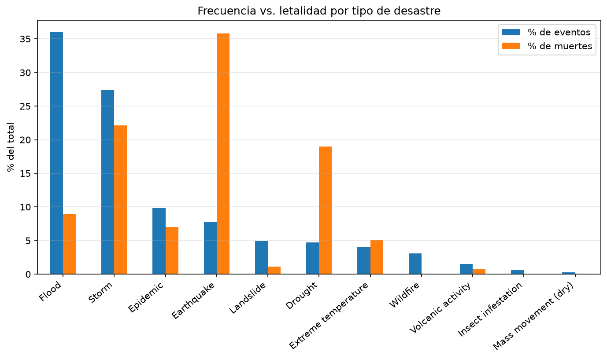

# Análisis de desastres naturales (EM-DAT, 1970-2021)

Pipeline ETL modular en Python/Pandas que limpia y analiza 14.644 registros de
desastres naturales para encontrar patrones temporales y geográficos.

## Hallazgos principales

- **Frecuencia no es letalidad:** las inundaciones son el 36 % de los eventos pero el
  9 % de las muertes; los terremotos son el 8 % de los eventos y el 36 % de las muertes.
- **La estacionalidad tiene dos picos** (enero y julio-agosto), pero el de enero está
  inflado por epidemias y sequías, y podría deberse a cómo se fechan los eventos.
- **El crecimiento del registro no equivale a más desastres:** gran parte del aumento
  desde 1970 refleja mejor cobertura.



## Qué hace el proyecto

- **Extract:** lectura y validación del dataset con rutas relativas.
- **Transform:** columna `fecha` (datetime64), análisis de estacionalidad, curación de
  categorías y ubicación (espacios, nombres de países, regiones inválidas, nulos) y cinco
  cruces de variables.
- **Load:** persistencia del dataset curado y generación de 9 gráficos.

Las decisiones de curación están justificadas en el notebook (por ejemplo, por qué las
variables numéricas con nulos no se imputan).

## Stack

Python · Pandas · NumPy · Matplotlib · Seaborn · Jupyter

## Estructura

```
├── data/            # dataset original
├── extract/         # lectura, validación y exploración
├── transform/       # fecha, curación y cruces
├── load/            # persistencia y gráficos
├── notebooks/       # análisis y reporte con apreciaciones críticas
└── main.py          # ejecuta el flujo ETL completo
```

## Cómo ejecutarlo

```
python -m venv .venv
.venv\Scripts\activate
pip install -r requirements.txt
python main.py
```

El análisis completo está en `notebooks/analisis_reporte.ipynb`.

## Fuente de los datos

EM-DAT, The International Disaster Database. Centre for Research on the Epidemiology
of Disasters (CRED), Universidad Católica de Lovaina, Bruselas.

## Autor

Agustin Barrios · [GitHub](https://github.com/barrioxs)